<picture>
  <source media="(prefers-color-scheme: dark)" srcset="assets/hero-dark.svg">
  
</picture>

I'm a Grade 12 student in Windsor, Ontario, and the co-founder of [Lemma](https://www.lemmaprep.ca). Most of what I know about software I learned by building things outside the classroom, lately with agentic AI. I work mostly in TypeScript and Python.

## Lemma

[Lemma](https://www.lemmaprep.ca) is the first prep platform built for Waterloo (CEMC) math contests. It gives each high-school student tailored guidance toward their best contest score, and it's built for students who can't afford private tutoring or want an alternative to it.

- Written permission from the University of Waterloo to use its contest material
- Admitted to the League of Innovators founder community (Oct 2026)

## Things I've built

**[Hearth](https://github.com/Shehwaz81/Brasle)** 
A glove that lets deaf-blind people hold a two-way conversation. AI shortens speech and buzzes it onto the glove as braille; the wearer answers in Morse code on a phone, which speaks it aloud. Built in a team of two at Hack the Nest 2026 on a Raspberry Pi 5 with Python, Claude and ElevenLabs. [Devpost](https://devpost.com/software/brasle)

**[Sayara](https://github.com/alialfoaady-cm/AI-Devfest)** 
Travellers lend their parked car at the airport and borrow one where they land, paid in credits instead of money. I built the Next.js web app on a team of five for the IBM watsonx challenge at Michigan DevFest 2026.

**[Alti Guard](https://github.com/Shehwaz81/alti-guard)** 
An AI observability MVP. I led the small team that built it during a 10-week internship at AltiCompany.

**[Can Drive](https://github.com/Shehwaz81/acscandrive)** 
The software behind my school's annual Can Drive. It replaced hand-logged donations, and students use it to book collection streets and follow their homeroom. The 2026 drive collected 23,533 cans against a goal of 20,000.

**[WRO Simulation](https://github.com/Shehwaz81/WRO-Simulation)** 
A pygame simulation of the World Robot Olympiad field, written so my robotics team could iterate quickly. The team placed 2nd at the WRO International Open in Panama (2025) and 3rd at the Canadian nationals (2026).

**[Signify](https://github.com/Shehwaz81/Signify)** 
Translates ASL into text with AI models. Built with a friend.

## Things I run

- **[ACS Hacks](https://github.com/Shehwaz81/ACS-Hacks)**: I founded my school's first hackathon and lead it. I've raised over $10,000 for the hackathons I've organized, and the 2027 edition is being planned now.
- **Computer Science Club**: president. I run the weekly sessions, where members build and present their own software.
- **Windsor Cubing**: a club I founded in 2025. We're working with the World Cube Association to bring Windsor its first official competition.

## Results

- 1st place, siberX Young Defenders of the North cybersecurity hackathon (2026)
- 2nd place, World Robot Olympiad International Open, Panama (2025)
- 3rd place, World Robot Olympiad Canadian nationals (2026)
- 3rd place, University of Windsor Secondary School Programming Competition (2025)
- Certificate of Distinction, Canadian Computing Competition (2026)
- University of Toronto National Book Award (2026)

The cube at the top is a real 20-move scramble being solved in 9 seconds, which is my 3×3 time.

Reach me at shehwaz.longia@gmail.com or [shehwazsaini.com](https://www.shehwazsaini.com).
